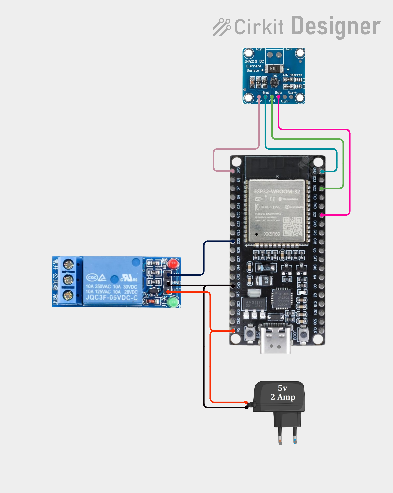

## 1. Hardware Wiring

| Signal | ESP32 Pin |
|---|---|
| I2C SDA | GPIO21 |
| I2C SCL | GPIO22 |
| Relay — Unified / Voltage | GPIO25 |
| Relay — Current | GPIO26 |
| Relay — Power | GPIO27 |
| BOOT button (factory reset) | GPIO0 (built-in) |
| Status LED | GPIO2 |

INA219 default addresses: `0x40`, `0x41`, `0x44`, `0x45` (Adafruit breakouts). Up to 6 sensors supported (0x40–0x4F).

## 2. Flashing

1. Open `ESP32_INA219_Production.ino` in Arduino IDE.
2. Install libraries: **Adafruit INA219**, **ESPAsyncWebServer**, **AsyncTCP**.
3. Select board: **ESP32 Dev Module** (or your variant).
4. Set partition scheme with enough NVS/app space (default 4MB with 1.2MB app is fine).
5. Upload.

## 3. First Boot & Wi-Fi

1. Power on. Device starts a Wi-Fi AP:
   - **SSID:** `ESP32_INA219`
   - **Password:** `12345678`
   - **IP:** `192.168.4.1`
2. Connect from phone/PC. Captive portal auto-redirects to the dashboard.
3. Open `http://192.168.4.1/` if needed.

## 4. Configure Sensors (`/sensors`)

For each of the 6 sensor slots:
- **Enable** the slot.
- Set **I2C address** (must be unique; duplicate addresses auto-disable the later one).
- Set **measurement range** (±320mV/32V, ±160mV/32V, or ±40mV/16V).
- Set **shunt resistance** in mΩ (e.g. `100` for 0.1 Ω).
- Set **voltage / current / power thresholds** (mV, mA, mW).
- Set **hysteresis %** (0–25) and **debounce samples** (1–20).
- Choose **relay routing** (Voltage→GPIO25, Current→GPIO26, Power→GPIO27).

Click **Save sensor settings**.

## 5. Configure Relays (`/relays`)

- **Active-low outputs** — enable for LOW-trigger relay modules.
- **Latch alarms** — relay stays on until acknowledged.
- **Min ON time** / **hold-off OFF time** — anti-chatter timing.
- **Sample interval** — how often sensors are read (100–60000 ms).
- **Manual override** — Auto / Force ON / Force OFF / 30 s ON per channel.

## 6. Wi-Fi Settings (`/wifi`)

- Change SSID (max 31 chars), password (8–63 chars, or empty = open AP), channel (1–13), max clients (4/8/10).
- Toggle **hidden SSID** and **captive portal**.
- **Apply** — AP restarts in ~1.5 s; reconnect to the new SSID.

## 7. Dashboard (`/`)

- Live voltage / current / power per sensor with sparkline history.
- Alarm banner + **Acknowledge all**.
- Relay state pills and quick manual controls.
- Runtime health: uptime, free heap, client count, config validity.
- Boot-button reset progress bar (hold GPIO0 for **5 s**).

## 8. Factory Reset

**Method A — Physical:** Hold the **BOOT (GPIO0)** button for **5 seconds** until the LED blinks rapidly; device reboots with defaults.

**Method B — Web:** `/wifi` or `/system` → **Factory reset** (confirm dialog) → device reboots.

## 9. System Diagnostics (`/system`)

Shows uptime, heap, min heap, sample/failure counters, NVS write/skip counts, and the config CRC64. Use for troubleshooting.

## 10. Operational Notes

- Config is stored in **two alternating NVS slots** with CRC64 + sequence; writes are debounced (3 s) and rate-limited (8 s min gap, 5 s boot guard).
- All numeric inputs are validated and clamped; invalid values fall back to defaults.
- Relay outputs start **de-energized** on every boot.
- GPIO25 is **shared** by the Unified and Voltage functions — it energizes if either demands it.
- No blocking delays; millis rollover handled via 64-bit software clock.
- Status LED: slow blink = normal, fast blink = boot button held / reboot armed, medium = alarm active.

## 11. REST API (optional)

- `GET  /api/status` — full runtime JSON
- `GET  /api/config` — current config JSON
- `POST /api/config/sensors` — form-urlencoded sensor settings
- `POST /api/config/relays` — relay behavior settings
- `POST /api/config/wifi` — AP settings (triggers AP restart)
- `POST /api/action` — `action=ack|relay|reboot|factory_reset|refresh_page` (factory_reset requires `confirm=yes`)
